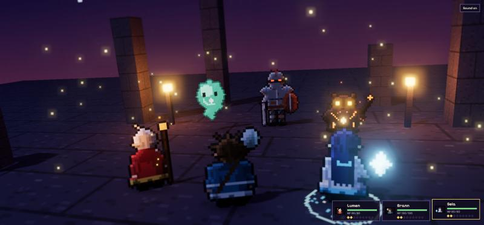
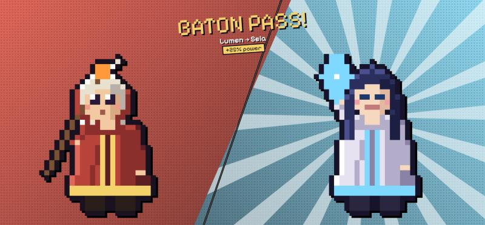
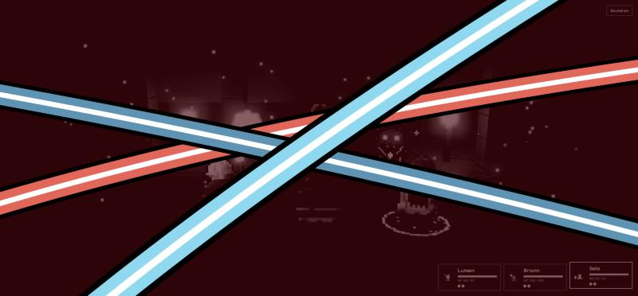
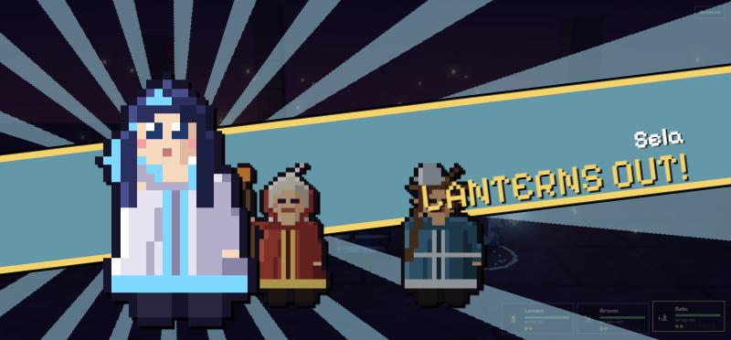

# Lantern Expedition

A turn-based pixel-art battle in the browser, in the HD-2D style: hand-made pixel sprites standing in a lit 3D
diorama with bloom, tilt-shift blur and dynamic shadows. The combat mixes Persona-style weakness rules with
Expedition 33-style real-time defense.



| Baton Pass | All-Out Attack | Finisher |
|---|---|---|
|  |  |  |

## Features

**Combat**
- **Weaknesses and One More.** Hit a weakness to knock an enemy down and earn another turn. Knock every enemy
  down to unlock the **All-Out Attack**.
- **Baton Pass.** On a One More turn, hand your turn to a teammate for a damage boost that grows with each pass.
- **Free Aim.** Spend a shot to aim at an enemy's glowing weak point. A weak-point hit counts as a weakness, even
  through resistances.
- **Combo parries.** Each enemy attacks with its own rhythm of 1–3 hits. Parry (tight window) or dodge (loose
  window) each one, and parry a whole combo to counterattack.
- **AP economy.** Attacks and parries build AP, and skills spend it. Ranged spells are cast from where the hero
  stands, while melee skills close the distance.

**Presentation**
- Over-the-shoulder camera with a personality per hero: a low heroic angle, a tilted dutch angle, or a slow orbit.
- Every sprite is drawn in code with front, back and side views, a 4-frame idle, smear frames, knockdown and
  victory poses, and auto-generated normal maps so torches and spells shade them like rounded forms.
- Cut-ins: a split-panel Baton Pass with a thrown lantern, and an All-Out sequence of eye cut-ins, brush
  strokes and a finisher card.
- A shattering intro transition, a letterboxed enemy reveal, hit stop, and particles and lights for each character.
- Chiptune sound effects synthesized with the Web Audio API.

## Controls

| Action | Keyboard | Mouse / touch |
|---|---|---|
| Choose commands and targets | Tab / Enter, Esc to go back | Click / tap |
| Parry an enemy hit | **Space** as the ring meets the circle | Parry button |
| Dodge an enemy hit | **D** | Dodge button |
| Free Aim | Arrow keys (Shift for fine), Enter to fire | Point and click |

## Run it locally

No build step. Serve the folder with any static server, then open http://localhost:5173.

```bash
python -m http.server 5173
```

Run the rules tests (Node 20+):

```bash
node --test
```

## How it's built

| File | What it does |
|---|---|
| `src/battle.js` | Pure battle rules with no DOM or 3D: turns, weaknesses, One More, baton pass, combos, All-Out. Covered by `src/battle.test.js`. |
| `src/data.js` | Heroes, enemies, skills, combo timings and each character's visual signature, all as data. |
| `src/sprites.js` | Procedural pixel art: shapes on a small grid, then shading, rim light and outline passes. Every pose and view comes from the same drawing code. Also draws all the spell effects. |
| `src/sheets.js` | Loads hand-made sprite sheets: keys out the magenta background, crops front/back/side views and builds the pose frames. |
| `src/stage.js` | The Three.js scene: billboard sprites, view selection, normal maps, lighting, particles, the camera director and post-processing. |
| `src/main.js` | The battle flow, menus, parry and aim input, and the 2D cut-ins. |
| `src/audio.js` | Battle music playback and synthesized sound effects. |

The rules engine only returns events. The presentation layer plays them back, which keeps the logic testable and
lets the visuals change without touching the game rules.

Built with [Three.js](https://threejs.org) 0.160 (loaded from a CDN) and the
[Pixelify Sans](https://fonts.google.com/specimen/Pixelify+Sans) font.

## Credits

- Code, effects art and sound effects: original to this project.
- Character sprite sheets (`assets/sprites/`): generated with Google Gemini from this project's character designs and
  palettes, then keyed and posed in code (`src/sheets.js`). The original code-drawn sprites in `src/sprites.js`
  remain as the fallback.
- Battle music: "8 BIT RPG BATTLE", a no-copyright retro game track. Check the track's own license terms before
  reusing it.
